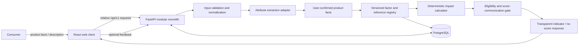

# Project Architecture — Environmental Impact Analyzer

> **Status:** Proposed architecture for the MVP
> **Last updated:** 2026-10-03
> **Implementation state:** An initial stateless web/API prototype exists. PostgreSQL, environmental datasets, model inference, and numeric scoring are not connected.

## 1. Architecture goals

- Keep environmental calculations deterministic, testable, and separate from language-model behavior.
- Preserve evidence and factor provenance from input through result.
- Ship a small, maintainable modular application before introducing separate services, queues, or caching infrastructure.
- Make missing data and incompatible assumptions explicit.
- Keep the browser independent of local machine URLs so the app can run behind a preview proxy or production reverse proxy.

## 2. Proposed stack

| Layer | Proposal | Rationale |
|---|---|---|
| Web client | React + TypeScript + Vite | Component-based, typed UI; simple static build and development workflow. |
| UI components and styling | Material UI (MUI) with a custom theme and CSS variables | Accessible, consistent form/layout primitives with the project’s warm editorial visual tokens; avoid default green “eco badge” styling. |
| API | Python + FastAPI + Pydantic | Typed request/response contracts, validation, and automatically generated OpenAPI docs; Python ecosystem supports data and NLP work. FastAPI is the selected Python API framework for this proposal. |
| Persistence | PostgreSQL; SQLAlchemy + Alembic | Relational provenance and assessment records, JSONB for controlled source metadata, versioned schema migrations. |
| NLP | Extraction interface with deterministic baseline; optional Hugging Face Transformers/PyTorch model behind that interface | Models can help find candidate fields but never determine numeric impact scores. Pin model, revision, and license before use. |
| Testing | pytest for API/domain; Vitest and React Testing Library for UI; API integration tests | Validate calculations, contracts, and user-visible states at the appropriate layer. |
| Local deployment | Docker Compose for web/API/database during development | Reproducible local setup. Production hosting and secrets management remain deployment decisions. |

This is a starting proposal. Prefer existing repository conventions if application code is added later, unless an explicit architecture decision record changes this stack.

## 3. System context



The React app calls the API using same-origin relative paths such as `/api/v1/assessments`; it must not call `localhost` or `127.0.0.1` from browser code. In development, configure the Vite proxy to forward `/api` to the API service. Bind preview/deployment servers to `0.0.0.0` and configure accepted hosts/origins for the actual environment.

## 4. Application boundaries

Start as one API deployable with domain modules; do not split into microservices until measured scale or ownership needs justify it.

```text
apps/web/                         React client
services/api/
  app/
    api/                           routes, request/response schemas
    products/                      product catalogue and matching
    assessments/                   orchestration and persistence
    extraction/                    NLP adapter and user-confirmed facts
    impact/                        units, factors, calculations, scoring
    sources/                       provenance and license metadata
    feedback/                      feedback intake
    core/                          settings, errors, logging, security
  migrations/                      Alembic migrations
  tests/
```

Keep route handlers thin. Domain logic must be callable without HTTP or a database so it can be unit-tested. External model execution and source-dataset imports sit behind explicit adapters.

## 5. Assessment data flow

1. Validate request size, category, enums, units, numeric bounds, and text length.
2. Normalize known product facts (for example, material synonyms and mass units) without discarding the user's original stated value or evidence.
3. If text is supplied, produce candidate attributes with field name, normalized value, original evidence span, extractor/model version, and confidence. The UI must ask for confirmation before those values affect a calculation.
4. Resolve applicable factor records by material/process, geography, year, boundary, and compatible impact method. A failed or ambiguous match remains unknown; it does not fall through to a convenient but incompatible factor.
5. Calculate impact indicators with versioned factors and unit-safe deterministic functions. Keep factor inputs and intermediate contributions available for audit.
6. Evaluate indicator eligibility and score-communication policy. Default to no overall consumer score. Never use PEFCR v3.1 single scores or representative-product comparisons in B2C communication; any distinct index needs separate expert/legal approval and validation.
7. Persist the assessment snapshot and provenance according to retention policy; return a response that explains scope, evidence, coverage, uncertainty, and method version.

### AI boundary

The extraction adapter may identify material names, percentages, mass, origin, or certification wording. It must return structured candidates with evidence spans. It must not decide that a claim is true, infer absent facts without labeling them, or generate factors, impact values, scores, citations, or recommendations. A deterministic rules/dictionary fallback must remain available. Model ID, immutable revision, license, and extraction configuration must be recorded for each extraction run.

## 6. Data model (logical)

| Entity | Key fields and purpose |
|---|---|
| `product` | Stable product identity, display name, brand (optional), category/subtype, and reviewed product-specific attributes. |
| `assessment` | ID, product snapshot, normalized input snapshot, status, functional unit, boundary, `methodology_version`, optional score, confidence, creation time, expiry/deletion time. |
| `assessment_indicator` | Assessment ID, indicator, value and unit, optional low/high estimate, stage, coverage, evidence class, and contributing factor/source IDs. |
| `assessment_attribute` | User-confirmed normalized field/value, evidence class, confirmation state, and extractor/model version where applicable. Keep candidate evidence spans in the transient preview response; do not persist pasted text or snippets by default. Store an evidence reference only when the user supplies it and retention/consent rules allow it. |
| `source_record` | Publisher, dataset/document ID and version, URL, retrieval date, geography/time coverage, license/terms, attribution, and permitted use. |
| `impact_factor` | Material/process, indicator and unit, geography, reference year, system boundary, method, source record, factor value, uncertainty/quality metadata, and immutable version. |
| `reference_distribution` | Product subtype, indicator, functional unit, boundary, distribution/version, eligible population, and reviewer approval state. |
| `feedback` | Assessment reference if available, structured reason, optional comment, consent/retention fields, and status; avoid personal identifiers. |

Use foreign keys and database constraints for valid categories, units, percentage sums where applicable, and factor/source relationships. Never overwrite a factor or reference distribution already used by an assessment; publish a new version and retain enough metadata to reproduce previous results.

## 7. API outline

All endpoints are versioned under `/api/v1`. Use JSON, documented request/response schemas, consistent error objects, and stable error codes.

**Implemented prototype routes:** `GET /healthz`, `GET /api/v1/methodology`, `GET /api/v1/sources`, `POST /api/v1/extractions/preview`, and `POST /api/v1/assessments`. The assessment endpoint is stateless and always returns `score: null`; it includes known facts and a no-score process-mapping readiness checklist for the inactive candidate source. The checklist highlights input gaps but does not match factors or calculate impact. Product search, feedback, persistence, and data-backed scoring remain planned.

### `POST /api/v1/extractions/preview`

Accepts a category and pasted description; returns candidate facts, evidence spans, and extraction metadata for the UI review step. It does **not** calculate an impact result and does not persist raw text or candidate snippets by default.

### `POST /api/v1/assessments`

Accepts structured product facts, including optional component/material shares and supplier process, output/reference-unit, input/loss, and waste-treatment notes, and returns a stateless no-score response with known facts, ordinary data gaps, and process-mapping readiness for the pinned candidate. It does not calculate environmental impact or accept unreviewed model output as authoritative. The checklist distinguishes absent evidence from user-provided but unverified loss/waste notes; it is not a factor-eligibility result. The client may submit confirmed values entered manually or suggested by the preview endpoint. Product/process evidence references are text only and are never fetched or persisted by the prototype.

Example confirmed assessment input:

```json
{
  "category": "apparel",
  "subtype": "t_shirt",
  "name": "Everyday T-shirt",
  "attributes": {
    "material_composition": [{"material": "cotton", "share_percent": 100, "provenance": "user_confirmed_extraction"}],
    "mass_g": 180,
    "manufacturing_country": null,
    "component_bom": [],
    "process_evidence": []
  }
}
```

Excerpt from the actual response (no environmental values are calculated):

```json
{
  "status": "not_scored",
  "methodology_version": "prototype-no-score-v0.4",
  "score": null,
  "process_mapping_readiness": {
    "source_id": "carbonfact-apparel-footwear-v1.1.0",
    "source_version": "1.1.0",
    "source_url": "https://github.com/carbonfact/lca-database-footwear-apparel/blob/v.1.1.0/README.md#whats-included",
    "status": "not_ready",
    "scoring_enabled": false,
    "note": "This checklist reports mapping inputs only; it is not an LCA result, does not estimate impact, and cannot activate the candidate source. License and method gates remain separate.",
    "requirements": [
      {
        "id": "process-route",
        "label": "Fiber, textile, and assembly process route",
        "status": "not_collected",
        "details": "The source has process-specific factors and reference units (for example, yarn, fabric, dyed textile, and assembled product). Material name or product subtype alone does not identify spinning, knitting/weaving, wet processing, or assembly.",
        "next_step": "Use supplier or product-spec evidence to identify applicable process technologies and archetypes; do not infer a route from the product label."
      }
    ]
  }
}
```

### Other routes

- `GET /api/v1/products?category=apparel&query=...` — search reviewed product/reference records.
- `GET /api/v1/products/{product_id}` — retrieve a product and available evidence.
- `GET /api/v1/assessments/{assessment_id}` — retrieve an assessment snapshot if persistence is enabled and the record has not expired.
- `POST /api/v1/feedback` — submit structured feedback.
- `GET /healthz` — liveness; a separate readiness check may validate required dependencies.

Defer arbitrary URL import and barcode lookup. If added later, use a dedicated allowlisted fetcher, block private/link-local IP ranges and redirects to them, limit response size/time, sanitize HTML, respect site terms, and never let the API make unrestricted server-side requests.

## 8. Data sourcing and ingestion

Maintain a source register before importing data. For each dataset, document source owner, dataset and release version, geography, time period, system boundary, impact method, license, attribution, redistribution rights, and transformation history. Review terms for both internal processing and user-facing derived results; public accessibility does not automatically grant redistribution or commercial use rights.

Candidate sources are options to evaluate, not assumed dependencies: LCA Commons repositories, openLCA Nexus datasets, ecoinvent (license required for many uses), product-specific environmental declarations, and manufacturer evidence. A domain expert must decide whether process-level data and methods are comparable to the chosen product boundary. Reject incompatible or untraceable data rather than silently mixing methodologies.

The current static source registry lists Carbonfact v1.1.0 solely for transparent review; it is not imported or active for scoring. A possible route is to use only the published pre-calculated impact-score CSVs under the stated CC BY-SA 4.0 license, while satisfying its attribution and ShareAlike conditions. The v1.1.0 README permits commercial use subject to those conditions; the publisher's current README adds specific product/platform obligations (linked same-screen attribution, retaining notices and informing users, marking changes, and releasing adapted/recalculated values served to customers under CC BY-SA 4.0 or a compatible license). Confirm with Carbonfact/legal counsel that the current guidance applies to the pinned release and that the service can comply; otherwise evaluate the publisher's separate commercial license. Do not infer ecoinvent rights from Carbonfact's license: the full underlying inventories are not distributed and require separate ecoinvent 3.12 rights. The registry exposes pending rights, product/process mapping, boundary/indicator, and validation gates; the UI can prepare an editable email draft but never sends it. No factor data are imported pending this review.

Pin an immutable release for reproducible evaluation because the current main-branch changelog records post-v1.1.0 impact-score changes and withdrawn files. The Apparel & Footwear PEFCR is a method reference rather than a factor dataset; its report restricts B2C use of its single score and comparisons against its representative products. The European Commission’s July 2026 transition guidance says existing PEFCRs remain valid until EF 4.0 is implemented and directs valid-PEFCR studies to a separate dataset hierarchy; it does not grant rights to use candidate datasets.

Ingestion should be an offline/admin workflow initially: validate schema and units, check duplicates and source terms, run data-quality checks, produce an import report, then publish an immutable factor/reference version. Do not scrape retailer sites for MVP.

## 9. Persistence, caching, and retention

PostgreSQL is the source of truth for reviewed products, assessments, feedback, factor metadata, and method versions. Do not add Redis or a distributed cache before load testing demonstrates a need. Cache keys, if introduced, must include normalized input hash, factor/reference version, and methodology version; invalidate on version change. Do not cache personal/free-text data without an explicit policy.

Default privacy direction: no account, no raw description retention by default, and a configured expiry/deletion path for anonymous assessment snapshots. The current API has no application persistence; hosting/proxy request-log retention has not been reviewed and must not be inferred from that fact. Final retention duration and user-facing deletion flow are release blockers, not implicit defaults.

## 10. Security, privacy, and operations

- Enforce request-size limits, input validation, output encoding, dependency updates, and rate limits on assessment/feedback routes.
- Do not log raw product text, secrets, or unnecessary identifiers. Log request IDs, timings, method versions, and non-sensitive error context.
- Keep secrets in environment/host secret management; commit only a documented `.env.example` with placeholders.
- Restrict CORS to the deployed app origin in production; use same-origin proxying where possible.
- Track health, latency, extraction failure, factor match/coverage rate, and calculation errors. Alert on errors that could produce misleading output.
- Keep the calculation library deterministic. A model/network outage must not change calculation results for confirmed inputs.

## 11. Deployment and testing strategy

- Local: Docker Compose for web, API, and Postgres; seed only explicitly licensed/synthetic development data.
- CI: formatting/lint/type checks, unit tests, API integration tests, migration checks, and a production build.
- Production: serve UI and API behind HTTPS/reverse proxy; use managed database backups, secret management, migration review, and a documented rollback path.
- Domain tests: unit conversions, material/process matching, boundary compatibility, indicator eligibility, no-score communication gates, missing-data behavior, and repeatability by method version.
- Integration tests: endpoint validation, persistence, source traceability, feedback flow, and error responses.
- UI tests: extraction review, unsupported-score state, partial results, comparison compatibility, keyboard access, and responsive layouts.

## 12. Architecture decisions to revisit

- Select the pilot geography and data providers after a licensing and coverage review.
- Decide whether extraction runs locally in the API or through a separate model service based on privacy, latency, cost, and model license.
- Choose a concrete retention duration and consent flow before enabling persisted anonymous assessments.
- Split out background jobs only if model/data import latency or throughput warrants it.
