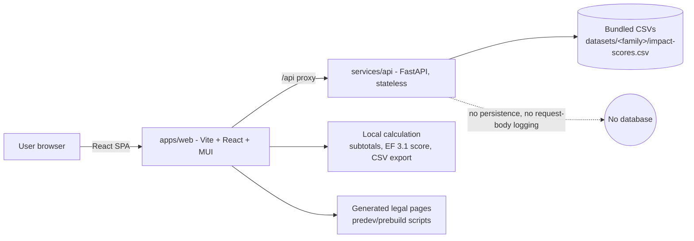
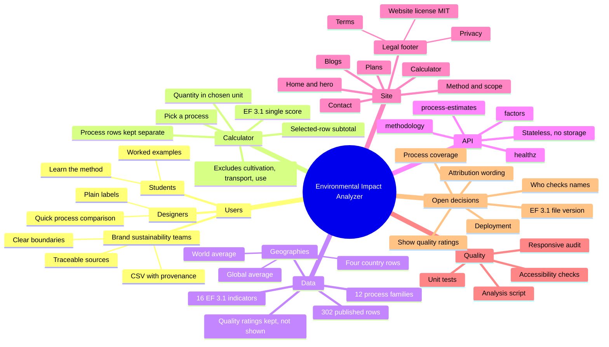

# Environmental Impact Analyzer: system deep dive and plan

_Last reviewed 2026-10-29. Covers the current state of the `arena/3c0af3fa-environmental-impact-analyzer` branch._

## 1. What the tool calculates, for whom, and why

**What it calculates.** For each process a user adds (for example, "cotton yarn spinning, 1 kg"), the app shows the published environmental factor for that process, scaled by the quantity the user enters. It shows 16 separate impact indicators for each row (EF 3.1 midpoint categories such as climate change, acidification, and fossil resource use). When several rows are selected, the app adds up each indicator across those rows and, optionally, combines the 16 indicators into one normalised and weighted EF 3.1 score.

**What it does not calculate.** It does not give a whole-product footprint. Cotton cultivation, ginning, transport, distribution, and use phase are not covered by the bundled open data (see `data-sources.md`). A "selected rows" total is therefore a partial picture, and the app says so.

**Why.** To let people see which processes in a product or material choice drive impact, and to compare process options at the same reference unit.

| Audience | What they need | What the tool gives them today |
|---|---|---|
| Designers | Quick, plain-language comparison of material and process choices | Calculator with process picker, quantities, and per-indicator results |
| Brand sustainability teams | Traceable, citable numbers with clear boundaries and sources | Source record, method page, CSV export with provenance columns |
| Students | Learning how life-cycle assessment works, with honest limits | Method and scope page, plain-language labels, worked examples |

## 2. Data inventory (what is kept and why)

| Item | Size or count | Kept? | Reason |
|---|---|---|---|
| Runtime impact-score CSVs (`datasets/<family>/impact-scores.csv`) | 12 files, 142 KB | Yes | The calculation reads these rows directly |
| Family README and source record (`SOURCE.md`, `SOURCE-RECORD.md`) | Small text | Yes | Source credit and provenance for every result |
| Dataset licence file (`LICENSE`) | Small text | Kept in repo for now | Shipped alongside the data; see decision D1 |
| Pruned Docker image data | 256 KB (estimated, not measured) | Yes | Excluding the unused large `datasets/sources/` trees keeps the image small |
| Analysis outputs (`docs/data/factors-clean.csv`, `factor-summary.md`) | 302 rows | Generated, not committed | Reproduced by `services/api/scripts/analyse_factors.py` |
| Quality ratings (DQR) | Present for each row | Kept in the clean file, not shown in UI | See decision D4 |

Data facts from the current analysis: 302 factors across 12 process families, 16 indicators per row. Geographies: World average (283), Global average (15), and one row each for Thailand, Indonesia, Côte d'Ivoire, and Vietnam. Families with most rows: spinning (159), dyeing (38), finishing (18).

## 3. Architecture

- **Browser (`apps/web`)**: calculator, results, subtotal, EF 3.1 score, CSV export, blog, method and legal pages. User-entered product details stay in browser memory.
- **API (`services/api`)**: four routes: `/healthz`, `/api/v1/methodology`, `/api/v1/factors`, `/api/v1/process-estimates`. Stateless. Validates 1 to 25 process rows and returns each row separately.
- **Data**: loaded from the bundled CSVs at start-up. Gzip is enabled for the factor list (703 KB plain, 67 KB gzip).
- **Build and deploy**: Docker Compose locally; Vercel config in `Dockerfile.vercel`. Vercel registry push was denied on the last production attempt (deployment `5DAfuoafR`), so production is not verified.

## 4. Mind map

## 5. Current state and gaps

- Working: calculator, API, subtotal and EF 3.1 score, CSV export, neo-brutalist styling, responsive header and menu, legal pages in footer, blog routes.
- Tests: API 10 pass; web 84 pass (vitest), `tsc` and `vite build` pass.
- Licence mentions removed from the site, API responses, the export, and the docs. The website's own MIT licence remains, as requested.
- Not verified: production deployment; image size (estimated only); legal pages are drafts for operator review.
- Known stale pieces: `Botanical.tsx` (unused), local checkout out of sync with this branch.

## 6. Decisions for the user

Each item is written so it can be answered without knowing the terms.

- **D1. Required credit for the source data (decided: CSV and source record only).** The source data asks for a credit line and "share-alike" (derived results must carry the same openness). The app shows the credit in the method dialog and CSV, and the source record is kept. Decision: the credit line is in every CSV row (`source_credit`) and in the source record, not on the calculator. Removing it entirely needs a legal review first.
- **D2. Process coverage (decided: all 12 families).**
- **D3. Who checks process names and the dtex assumption?** Process names come from the source descriptions and may be hard to read. The cotton report assumes a 330 dtex spinning-to-knitting match. Confirm who reviews these before launch.
- **D4. Show data-quality ratings? (decided: keep hidden for now).** The ratings are kept in the clean data file. Revisit once the audience is confirmed.
- **D5. Which EF 3.1 file version is official?** The normalisation and weighting values are transcribed from JRC files. Confirm the version to cite.
- **D6. Production deployment.** Vercel push was denied. Confirm the hosting target before launch.
- **D7. Legal pages.** Privacy, terms, and website licence pages are drafts. Confirm the operator name, contact, governing law, and jurisdiction.

## 7. Next moves (proposed order)

1. Confirm D3, D5, D6, and D7 (still open). Confirm the legal text matches D1.
2. Resolve deployment (D6) and confirm the production route serves the calculator.
3. Measure the Docker image instead of estimating it.
4. Add a short walkthrough for students and a "how to read the result" note for designers.
5. Remove unused `Botanical.tsx` and sync the local checkout.
